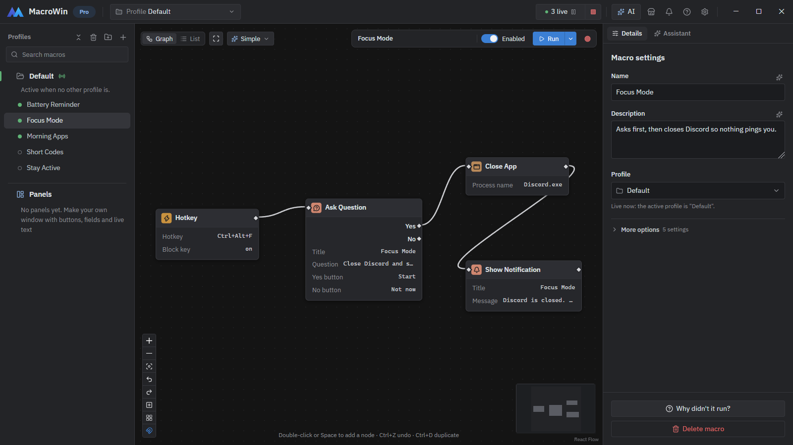
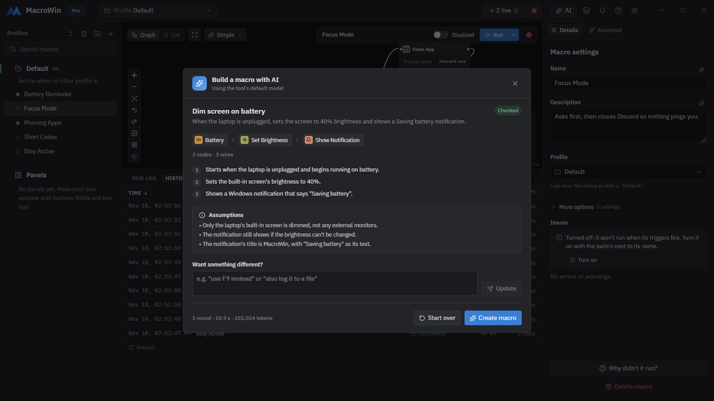

# MacroWin MCP server

Let the AI apps you already use work with your Windows macros. Claude Desktop, Claude Code, Cursor, VS Code with
GitHub Copilot, Codex, Gemini CLI, Windsurf, ChatGPT's desktop app and any other MCP client can read your
[MacroWin](https://macrowin.org/?ref=github-mcp) macros, explain why one didn't run, and propose new or changed
macros. **Nothing changes until you confirm it in MacroWin.**

MacroWin is a macro app for Windows 10 and 11: a trigger (a hotkey, a short code you type, a schedule, an app
opening, a USB drive, your voice: 60+ in all) starts a macro, and steps (270+ of them: typing and clicking,
apps and windows, files, websites, email, reading the screen) do the work. The MCP server is built into the app.

> This repository holds the documentation for MacroWin's MCP server. MacroWin itself is a free download from
> [macrowin.org](https://macrowin.org/download?ref=github-mcp); its source code isn't public.



## What your AI app can do

**Read** (answered at once, passwords and keys left out):

| Tool | What it does |
|---|---|
| `list_macros`, `get_macro` | Your macros, their triggers and steps |
| `why_not_run` | Why a macro didn't run when you expected, in a sentence |
| `list_runs`, `get_run` | Run history, step by step |
| `list_hotkeys` | Every hotkey in use, to find a free one |
| `search_nodes`, `get_node_details` | MacroWin's triggers, conditions and steps |
| `list_profiles`, `list_modes`, `list_panels`, `get_panel` | Profiles, modes and your own panels |
| `list_variables`, `get_settings` | Variables (passwords masked) and settings |
| `run_troubleshooting` | MacroWin's troubleshooting checks |
| `search_hub` | Ready-made macros on the Macro Hub |

**Propose** (each one shows up in MacroWin as a card you confirm or decline):

`create_macro`, `change_macro`, `rename_macro`, `duplicate_macro`, `move_macro`, `delete_macro`,
`set_macro_enabled`, `run_macro`, `test_step`, `create_profile`, `create_mode`, `change_mode_rule`,
`create_panel`, `change_panel`, `set_variable`, `change_settings`, `run_troubleshooting_fix`,
`install_from_hub` and more. Your app learns the outcome through `get_proposal_status`.

Example prompts:

- "Why didn't my Stand Up Reminder macro run this morning?"
- "Make a macro that types my email signature when I type ;sig."
- "Which hotkeys are still free with Ctrl+Alt?"
- "My Auto-Clicker clicks too fast. Make it every 250 ms."

## Setup

1. Install MacroWin from [macrowin.org/download](https://macrowin.org/download?ref=github-mcp).
2. In MacroWin, open **Settings > AI > AI apps on this PC** and switch on
   **Let AI apps on this PC use MacroWin** (it's off by default).
3. Open **Help > Ask your AI** and pick your app. For most apps, **Add MacroWin to ...** shows the settings file
   it will change and changes it only when you click **Change it**. Or add it by hand:

```json
{
  "mcpServers": {
    "macrowin": {
      "command": "C:\\Users\\<you>\\AppData\\Local\\Programs\\MacroWin\\MacroWin.exe",
      "args": ["--mcp"]
    }
  }
}
```

   Use the folder you installed MacroWin in (the one above is the default for "Just me").

4. Restart your AI app. The first time it connects, MacroWin asks
   "Allow ... to read your macros and propose changes?".

Full guide: [macrowin.org/docs/guides/ai](https://macrowin.org/docs/guides/ai?ref=github-mcp#ai-apps-on-your-pc-mcp)

## How it stays safe

- **Stays on your PC.** `MacroWin.exe --mcp` talks to MacroWin over a named pipe for your Windows user. There's no
  network port.
- **Off until you switch it on**, and each app is allowed only after you say yes. **Revoke** takes access away.
- **You confirm every change.** Proposals wait as cards in MacroWin's assistant panel (or a Windows notification
  when the editor is closed). New macros are saved switched off.
- **No secrets.** Passwords and keys never reach the AI app; they're shown as names only.
- **Locked means locked.** While MacroWin's App lock is on, apps get only "MacroWin is locked".

## Requirements

- Windows 10 or 11, 64-bit
- MacroWin with Pro or the free 14-day trial (no card needed). MacroWin's Free plan doesn't include AI features.
- Any MCP client that can start a local (stdio) server

## Links

- Website: [macrowin.org](https://macrowin.org/?ref=github-mcp)
- Features: [macrowin.org/features](https://macrowin.org/features?ref=github-mcp)
- Try the editor in your browser: [macrowin.org/demo](https://macrowin.org/demo?ref=github-mcp)
- Pricing: [macrowin.org/pricing](https://macrowin.org/pricing?ref=github-mcp)
- Video: [the MacroWin trailer](https://www.youtube.com/watch?v=cSqsaEOJGUQ)
- Support: info@macrowin.org or [macrowin.org/docs#support](https://macrowin.org/docs?ref=github-mcp#support)



© 2021-2026 MacroWin by WaveBit. MacroWin is proprietary software; this repository contains documentation only.
